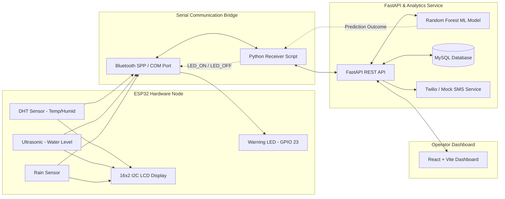

# FloodGuard: IoT-Enabled ESP32 Flood Monitoring & Early Warning System

FloodGuard is an end-to-end real-time flood monitoring, machine learning risk prediction, and early warning platform. The system acquires environmental telemetry via an **ESP32 microcontroller**, streams data wirelessly via **Bluetooth SPP** to a **FastAPI** backend, evaluates live flood risk using a trained **Random Forest Machine Learning model**, actuates a physical **GPIO 23 warning LED** over a closed-loop acknowledgment protocol, persists all readings and predictions to a **MySQL** database, and visualizes real-time metrics on an interactive **React (Vite)** dashboard with simulated/live **Twilio SMS alerts**.

---

## Architecture Overview



---

## Hardware Configuration & Pinout

ESP32 microcontroller pin mappings (configured in `esp32/Arduino/FloodGuard_ESP32/FloodGuard_ESP32.ino`):

| Component / Sensor | Sensor Model / Spec | ESP32 Pin | Function |
| :--- | :--- | :--- | :--- |
| **Temperature & Humidity** | DHT11 / DHT22 | `GPIO 4` | Ambient temperature and humidity monitoring |
| **Rainfall Sensor** | Resistive Rain Sensor | `GPIO 34` (ADC1) | Analog rain intensity detection |
| **Water Level Sensor** | HC-SR04 Ultrasonic | Trig: `GPIO 5`<br>Echo: `GPIO 18` | Distance measurement to calculate water level |
| **LCD Display** | 16x2 Character LCD | SDA: `GPIO 21`<br>SCL: `GPIO 22` | Real-time on-site metric display (`0x27` I2C address) |
| **Physical Alert Indicator** | 5mm High-Brightness LED | `GPIO 23` | Closed-loop prediction alert (Active HIGH) |
| **Serial Communication** | ESP32 Bluetooth Classic | Built-in Antenna | SPP Profile (`FloodGuard_ESP32`) |

---

## Tech Stack

- **Microcontroller & Embedded Firmware**: C++ / Arduino IDE (`BluetoothSerial`, `LiquidCrystal_I2C`, `DHT`, `Wire`)
- **Bluetooth Bridge**: Python 3 (`pyserial`, `requests`)
- **Backend API**: Python 3, FastAPI, Uvicorn, Pydantic, SQLAlchemy 2.0, PyMySQL
- **Machine Learning**: Scikit-Learn (Random Forest Classifier), Pandas, NumPy, Joblib
- **Database**: MySQL 8.0+ exclusively via SQLAlchemy 2.0 & PyMySQL
- **Frontend**: React 19, Vite, Tailwind CSS, Lucide Icons, Recharts
- **Notification Services**: Pluggable Twilio REST API + Zero-cost Mock SMS Provider

---

## Repository Structure

```text
Flood_Risk_ESP32_Project/
├── .env.example                  # Environment configuration template
├── .gitignore                    # Git exclusions (credentials, caches, large files)
├── Flood_Risk_Model_v2.ipynb     # V2 basin-level hydrological model notebook
├── package.json                  # Root npm workspace shortcuts
├── requirements.txt              # Backend and ML Python dependencies
├── train_rf_model.py             # Script to train production Random Forest model
│
├── backend/
│   ├── main.py                   # FastAPI entrypoint and middleware
│   ├── database.py               # MySQL engine pool and session management
│   ├── database_sms.py           # SMS logging and recipient database operations
│   ├── migrate_to_mysql.py       # Data migration utility (SQLite to MySQL)
│   ├── verify_status.py          # MySQL database health & status checker utility
│   ├── test_api.py               # REST API test suite
│   ├── test_receiver_led.py      # Bidirectional LED and ACK test suite
│   ├── test_rf_integration.py    # Random Forest inference integration tests
│   ├── test_sms.py               # Pluggable SMS provider unit and mock tests
│   ├── test_v2_integration.py    # V2 experimental model test suite
│   ├── routes/
│   │   ├── alerts.py             # Alert queries and telemetry snapshot endpoints
│   │   ├── prediction.py         # /predict/rf and model evaluation endpoints
│   │   ├── sensor.py             # Live sensor ingestion and polling endpoints
│   │   └── sms.py                # SMS dispatch and provider status endpoints
│   └── services/
│       ├── prediction_service.py # Feature engineering and model inference loader
│       ├── sms_service.py        # SMS orchestrator (rate limiting, whitelist)
│       └── providers/            # Base, Mock, and Twilio SMS providers
│
├── bluetooth/
│   └── receiver.py               # Bidirectional Bluetooth SPP bridge script
│
├── dataset/
│   ├── flood_model_rf_dataset.csv     # Dataset for active Random Forest model
│   └── flood_training_data_v2.csv     # CWC multi-basin river observation dataset
│
├── esp32/
│   └── Arduino/
│       └── FloodGuard_ESP32/
│           └── FloodGuard_ESP32.ino   # Official ESP32 firmware
│
├── frontend/
│   ├── index.html                # Vite HTML root
│   ├── package.json              # Frontend dependencies and scripts
│   ├── vite.config.js            # Vite build configuration and proxy setup
│   ├── public/                   # Static icons and assets
│   └── src/
│       ├── App.jsx               # Navigation router and app shell
│       ├── components/           # UI cards, charts, and connection panels
│       ├── pages/                # Dashboard, LiveMonitoring, Alerts, SystemStatus
│       └── services/api.js       # Centralized REST client
│
└── model/
    ├── flood_model_rf.pkl        # Active production Random Forest model (~145 KB)
    ├── flood_model_rf_metrics.json # Production accuracy and evaluation metrics
    └── flood_model_v2.pkl        # Experimental V2 hydrological danger model (~2.1 MB)
```

---

## Getting Started

### 1. Prerequisites
- **Python**: 3.10, 3.11, or 3.14
- **Node.js**: v18 or later
- **MySQL Server**: 8.0+ running locally on port 3306
- **Arduino IDE**: 2.x with ESP32 board support installed

---

### 2. Backend Setup
1. Create and activate a Python virtual environment:
   ```bash
   python -m venv venv
   # Windows:
   .\venv\Scripts\activate
   # Linux/macOS:
   source venv/bin/activate
   ```
2. Install Python dependencies:
   ```bash
   pip install -r requirements.txt
   ```
3. Set up the environment configuration:
   ```bash
   cp .env.example .env
   ```
   Edit `.env` to configure your MySQL root password and Twilio keys (or keep `SMS_PROVIDER=mock` for free simulated alerts):
   ```ini
   DB_ENGINE=mysql
   MYSQL_HOST=127.0.0.1
   MYSQL_PORT=3306
   MYSQL_USER=root
   MYSQL_PASSWORD=your_mysql_password
   MYSQL_DATABASE=floodguard

   SMS_PROVIDER=mock
   ```
4. Initialize the database and verify table health:
   ```bash
   python backend/verify_status.py
   ```
5. Start the FastAPI server:
   ```bash
   uvicorn backend.main:app --reload --host 127.0.0.1 --port 8000
   ```
   Interactive API docs are available at: `http://127.0.0.1:8000/docs`

---

### 3. Frontend Setup
1. Navigate to the frontend directory:
   ```bash
   cd frontend
   npm install
   ```
2. Launch the Vite development server:
   ```bash
   npm run dev
   ```
   Open your browser at `http://localhost:5173`.

---

### 4. ESP32 Firmware & Bluetooth Bridge
1. Open `esp32/Arduino/FloodGuard_ESP32/FloodGuard_ESP32.ino` in Arduino IDE.
2. Select your board (`ESP32 Dev Module`) and target COM port.
3. Upload the firmware.
4. Pair your computer with the Bluetooth device `FloodGuard_ESP32`.
5. Identify the outgoing Bluetooth Serial COM port in Windows Device Manager.
6. Start the Bluetooth bridge:
   ```bash
   python bluetooth/receiver.py --port COMx
   ```

---

## Machine Learning & Inference Pipeline

The active production model is a **Random Forest Classifier** (`model/flood_model_rf.pkl`) trained with 12 engineered features:

| Base Features | Engineered Interaction Features |
| :--- | :--- |
| `Latitude`, `Longitude` | `Rainfall_Humidity` = `Rainfall * Humidity` |
| `Rainfall (mm)` | `Rainfall_WaterLevel` = `Rainfall * Water_Level` |
| `Temperature (°C)` | `Humidity_WaterLevel` = `Humidity * Water_Level` |
| `Humidity (%)` | `Elevation_Risk` = `(Water_Level * 10) / (Elevation + 1)` |
| `Water Level (m)`, `Elevation (m)` | `Log_Elevation` = `log1p(Elevation)` |

To retrain the production model:
```bash
python train_rf_model.py
```

### Model Architecture & Versioning
- **Production Model (`model/flood_model_rf.pkl` - 145 KB)**: Random Forest Classifier trained on sensor telemetry and topological interactions. Powers the active `/predict/rf` endpoint, live ESP32 Bluetooth bridge, and physical LED warning system.
- **Experimental Model (`model/flood_model_v2.pkl` - 2.1 MB)**: Multi-basin hydrological risk model trained on Central Water Commission (CWC) river monitoring records. Accessible via `/predict/v2-experimental` for exploratory regional forecasting.

---

## Verification & Test Suites

Run the automated test suites from the project root:

```bash
# Test 1: Random Forest Model & Feature Pipeline Integration
python -m unittest backend/test_rf_integration.py

# Test 2: Bidirectional Bluetooth LED Actuator & Hardware ACK
python -m unittest backend/test_receiver_led.py

# Test 3: SMS Gateway & Whitelist Validation (Mock + Twilio)
python -m unittest backend/test_sms.py

# Test 4: Database Parity & Connection Pool Check
python backend/verify_status.py

# Test 5: Frontend Production Build
npm --prefix frontend run build
```

---

## Security & Privacy Notice
- Never commit `.env` or production credentials to source control.
- All database access requires environment variables.
- Twilio Auth Tokens are never logged or exposed via API responses.
- Production SMS dispatches are protected by a strict recipient whitelist.

---

## License
This project is open-source under the MIT License.
